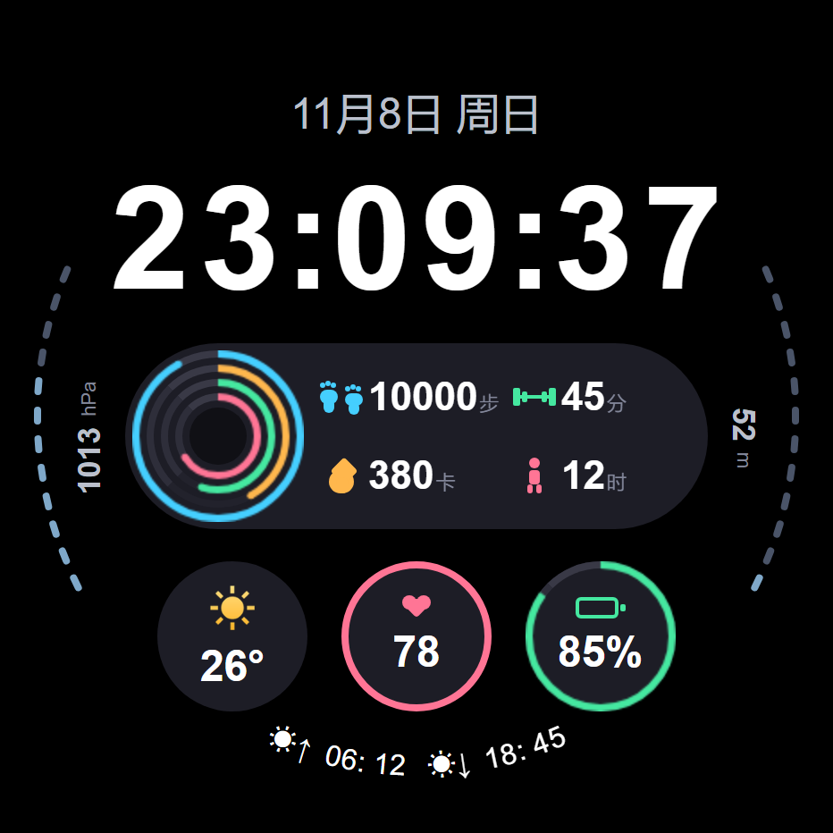
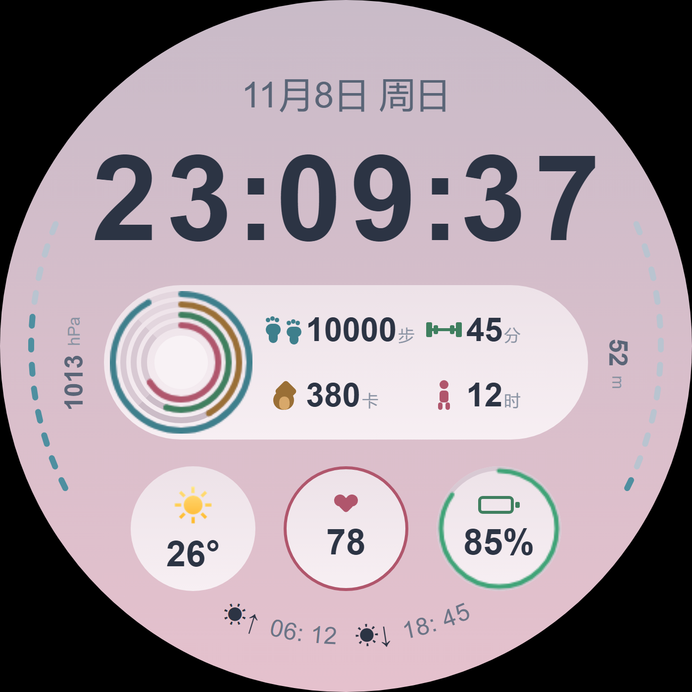
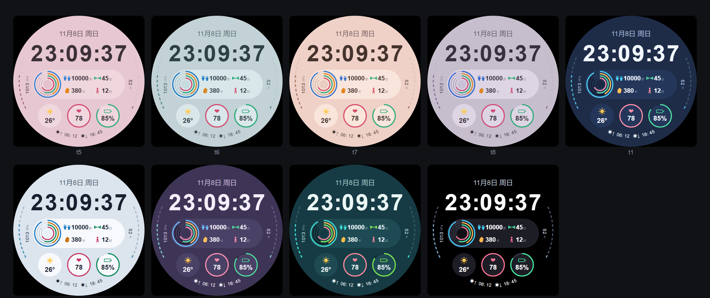

# 深海脉冲 · Deeppulse

> 为 vivo / iQOO 蓝河（BlueOS）圆表设计的数字表盘。以低饱和深海色打底、单一强调色提亮，把步数、活动、热量、站立四项数据压进一枚悬浮胶囊，四环进度全部用真实圆弧绘制。设计基准 466×466，支持九套配色切换与 AOD 常亮。
>
> 网页版：[index.html](index.html)

---

## 表盘预览

 

*左：墨黑（默认）　右：藕粉*

---

## 设计要点

### 四环真圆弧

步数 / 活动时间 / 热量 / 站立四层进度环用 canvas 的 `arc` 绘制，不是分段矩形拼的折线，任意百分比下外缘都是正圆；相邻环留 4px 净间隙，四层不粘连。

### 贴边极坐标刻度

左侧气压、右侧海拔沿表盘边缘以 12 段、−68°~−116° 的角度范围排布，数值与刻度分离，读写不互相干扰；底部日出日落沿 R=201 弧线逐字旋转。

### 纯矢量图形

脚印、杠铃、火焰、立姿人四个图标与全部装饰均由样式绘制，不依赖图片资源，也不使用 emoji 字符，避免手表端字库缺失渲染成方框。

---

## 九套配色

墨黑 · 藕粉 · 雾青 · 粉米 · 灰紫 · 午夜靛 · 月白 · 雾紫暮 · 深海青 —— 点四环环心循环切换，配色随本地存储保留。

---

## 技术规格

| 项 | 说明 |
| --- | --- |
| 适配设备 | vivo / iQOO 手表，`watch-round` **466×466** 圆表 |
| 开发方式 | BlueOS Studio + `.ux` 单文件组件（template / script / less） |
| 包名 / 版本 | `com.lisixin.watch.deeppulse` · v1.5.6 |
| 安全区 | 80px 整行时间包围盒四角距圆心最远 229.1（半径 233），全元素逐点核算 |
| 功耗处理 | AOD 常亮下心率 / 电量 / 日月面板降频至每 5 分钟；气压回调与主题重建分帧执行 |
| 健壮性 | canvas 取不到上下文时只丢进度、不丢环；存储缺失时主题回落默认色，全程不崩 |

---

## 构建产物

**深海脉冲 · rpk 安装包**

- versionName `1.0.0` · versionCode `10` · 2026-11-05 构建 · 293 KB
- 包名 `com.lisixin.watch.bluetide`（历史命名，当前开发分支为 `deeppulse`）
- 下载：[com.lisixin.watch.bluetide.release.production.1.0.0(10).rpk](<builds/com.lisixin.watch.bluetide.release.production.1.0.0(10).rpk>)

---

## 关于作者

独立表盘开发者，专注信息型数字表盘：把尽可能多的数据放进一眼能读完的层级里，而不是靠装饰堆视觉。开发环境为 BlueOS Studio，作品均在自己的真机上完成渲染、功耗与 AOD 自查。

作品全部原创，图形与图标为自行绘制，不含第三方素材。

`数字表盘` `极简` `多配色` `信息型` `vivo / BlueOS`

---

*深海脉冲 Deeppulse · 作品集 · 更新于 2026 年 11 月*
