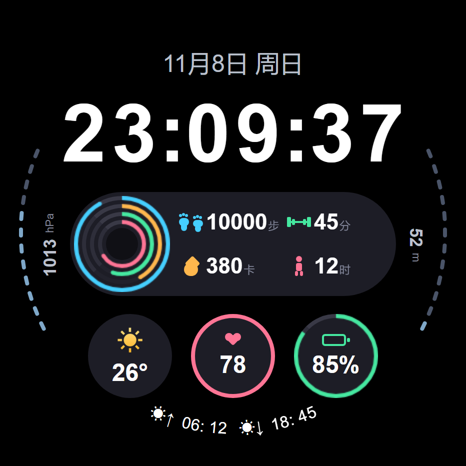
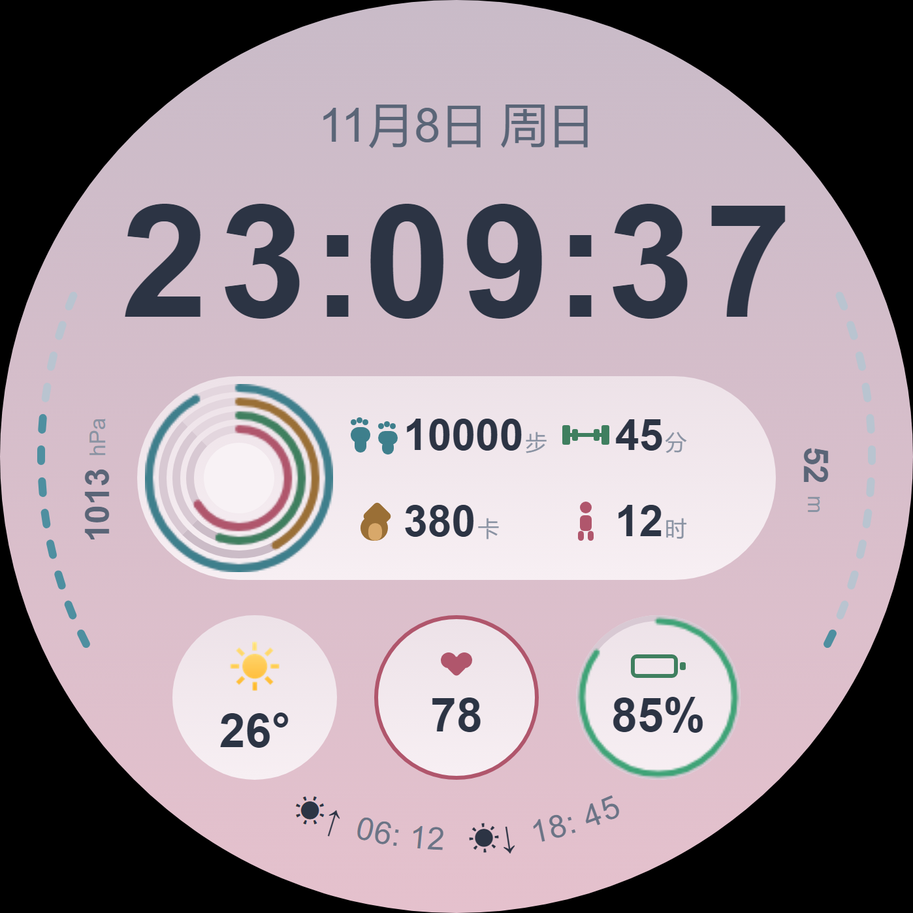

# 深海脉冲 · Deeppulse

vivo / iQOO 蓝河（BlueOS）圆表数字表盘的作品集仓库：预览渲染图、九套配色对照、技术规格与 rpk 构建产物。

> 设计基准 466×466 · 四环真圆弧进度 · 九套配色 · AOD 降频

## 预览

 

## 设计要点

- **四环真圆弧**：步数 / 活动时间 / 热量 / 站立四层进度用 canvas `arc` 绘制，不是分段矩形拼接，任意百分比下外缘都是正圆；相邻环 4px 净间隙。
- **贴边极坐标刻度**：左侧气压、右侧海拔沿表盘边缘 12 段排布（−68°~−116°），数值与刻度分离；底部日出日落沿 R=201 弧线逐字旋转。
- **纯矢量图形**：脚印 / 杠铃 / 火焰 / 立姿人四个图标与全部装饰均由样式绘制，零图片依赖，不使用 emoji 字符（避免手表端字库缺失渲染成方框）。

## 技术规格

| 项 | 值 |
| --- | --- |
| 适配设备 | vivo / iQOO 手表，watch-round 466×466 圆表 |
| 开发方式 | BlueOS Studio + `.ux` 单文件组件 |
| 安全区 | 80px 整行时间包围盒四角距圆心最远 229.1（半径 233） |
| 功耗处理 | AOD 常亮下心率 / 电量 / 日月面板降频至每 5 分钟；气压回调与主题重建分帧执行 |
| 健壮性 | canvas 取不到上下文时只丢进度不丢环；存储缺失时主题回落默认色 |

## 构建产物

| 文件 | 说明 |
| --- | --- |
| `builds/com.lisixin.watch.bluetide.release.production.1.0.0(10).rpk` | versionName 1.0.0 / versionCode 10，2026-11-05 构建。**包名仍为历史命名 bluetide**，当前开发分支已改为 `com.lisixin.watch.deeppulse` |

## 目录结构

```
.
├── index.html     作品集单页（可直接开启 GitHub Pages）
├── img/           预览渲染图
└── builds/        rpk 构建产物
```

## 开启在线预览（GitHub Pages）

仓库 Settings → Pages → Source 选 `Deploy from a branch` → 分支 `main`、目录 `/ (root)` → Save。
一分钟后访问 `https://<用户名>.github.io/<仓库名>/`。

## 版权

图形、图标与页面代码均为作者原创，保留所有权利。未经许可不得二次分发、
不得以本作品名义上架应用商店或表盘商店。预览图为样式渲染，非实机照片。
